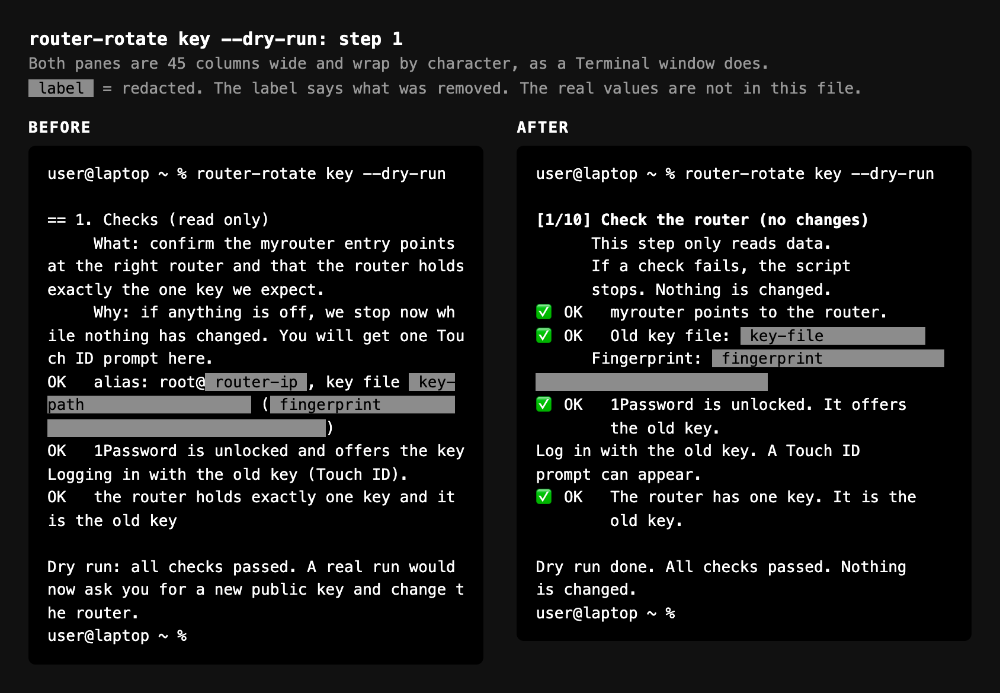

# Prompt: rewrite user-facing text in ASD-STE100

A prompt to give an AI coding assistant when scripts, error messages and written steps must be easy to follow in a hurry or under stress.

Hat-tip to [Christopher Penn](https://www.christopherspenn.com/) for the advice to try ASD-STE100.

## When to use it

- A script prints instructions, prompts or errors that a person must act on.
- A runbook or recovery plan must be followable when the reader is worried or in a panic.
- The text mixes explanations into the steps.

## The prompt

Copy everything in the box.

```
Review all user-facing text in this project and rewrite it in ASD-STE100 (Simplified Technical English).
User-facing text means: script output and prompts, error messages, and the written steps (runbooks and plans).
The reader may be stressed or in a hurry, so the text must be easy to follow.

Rules:
- One action per step. Short sentences, about 20 words or fewer.
- Active voice and command form ("Open the file."). Use "Do not" for prohibitions.
- Use one word for one thing. Do not change the word halfway.
- After each step that can fail, state the expected result. Give a plain STOP line that says what to do when the result is different.
- Keep reasons and background out of the steps. Keep one or two short lines at most.
- When something fails, say what state the system is in (for example "Nothing is changed.").

Status markers (always put the word next to the emoji):
- ✅ OK for success
- 🟡 NOTE for a warning or a note
- 🛑 STOP for a stop
- ❌ FAIL for a failed check

Terminal output only (script output, prompts and error messages). Skip this for documents:
- Use only emoji that are two columns wide. Do not use ⚠️: many terminals draw it one column wide and the text after it shifts.
- Wrap text to the real window width. Read the width at run time. Keep long values, such as paths and fingerprints, on a line of their own.
- Put the markers in a fixed-width column so wrapped lines line up under the text.

Documents only (runbooks and plans):
- Give each step a bold label, such as "Step 1.", and put each command in a code block.
- Do not hard-wrap lines. Let each paragraph flow to its natural length.

Do not change what the commands do. Do not put secrets in any output. Update every document that quotes the old messages.
```

## Example: before and after

The same step of a script that rotates a router's SSH key, before and after the prompt. The names in the picture are generic. Both panes are 45 columns wide and wrap by character, as a Terminal window does. Gray bars hide private values, and each bar names what it hides.



<details>
<summary>Text version of the "after" output (45 columns)</summary>

```
user@laptop ~ % router-rotate key --dry-run

[1/10] Check the router (no changes)
      This step only reads data.
      If a check fails, the script
      stops. Nothing is changed.
✅ OK   myrouter points to the router.
✅ OK   Old key file: [key-file]
      Fingerprint: [fingerprint]
✅ OK   1Password is unlocked. It offers
        the old key.
Log in with the old key. A Touch ID
prompt can appear.
✅ OK   The router has one key. It is the
        old key.

Dry run done. All checks passed. Nothing
is changed.
user@laptop ~ %
```

</details>

## What the prompt does

- **Names the standard exactly.** It is ASD-STE100 ([the specification](https://www.asd-ste100.org/)).
- **Lists what counts as user-facing.** Expand or retract the scope by modifying the list.
- **Puts the rules in the prompt.** Without the rules, the model uses its own interpretation of the standard.
- **Names the reader's state of mind.** The phrase "stressed or in a hurry" gives the model the rationale behind the request.
- **Puts the word beside the emoji.** A word works in a search, works if the emoji does not display, and works when read aloud.
- **Selects emoji with consistent width.** ✅, 🛑, 🟡 and ❌ are always two columns wide, so the labels line up visually in a terminal.
- **Separates terminal rules from document rules.** Wrapping to the window width and fixed columns make sense only in a terminal. In a document they do harm, so a document gets its own rules.

## Notes

- **Not certified.** A rewrite in the style of STE is not certified STE.
- **The best checker is a person.** One reader saying "this step lost me" is worth more than any automatic check. Give a before and after the reader can compare side by side.
